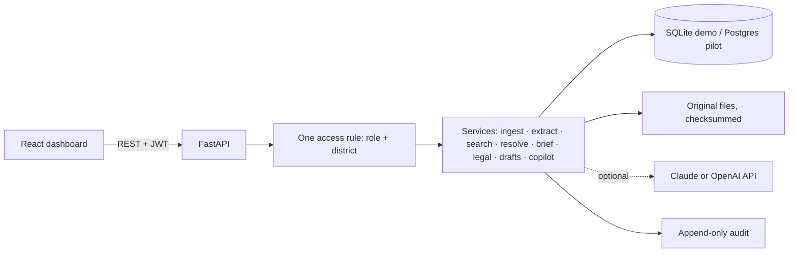

# u-FIR Nexus: AI-Enabled Unified First Information Report

**Challenge:** AI-Enabled Unified FIR · AP Prohibition & Excise Department · AI Living Labs Foundation (Hackathon ID HCK_8E2E98DE568DB1A4)
**One line:** an evidence-first intelligence layer over existing Excise case files. Every AI statement links to its source passage, every uncertain match stays reviewable, and the officer stays in control.

> Prototype on **synthetic data only** (no real records, accused persons or live systems). Full limits: [docs/LIMITATIONS.md](docs/LIMITATIONS.md).

## The problem and our approach
Excise case records are free text in many station formats. Officers search by hand, miss repeat offenders hidden behind spelling variants, and retype diaries and chargesheets. u-FIR Nexus reads records **as they are written today** (no template change for officers) and turns them into: searchable facts → a cited case brief → explainable links → reviewed drafts → an audit trail.

## Official capabilities and outcomes → what to look at
| Brief | Delivered | Screenshot |
|---|---|---|
| C1/O1 Messy files → searchable data | Ingest of text, PDF and scanned images (open-source OCR), fact extraction with source quotes, search tolerant of spelling/transliteration variants | [04](docs/screenshots/04-search-spelling-variants.png) |
| C2 Understand a case quickly | Case Cockpit: cited brief, timeline, conflicts, missing information, one-click source highlighting | [02](docs/screenshots/02-case-cockpit-cited-brief.png) |
| C3 Suggest laws/sections | Catalogue-limited suggestions with cited facts and passages; abstains when facts are thin; accept/reject with reasons | [03](docs/screenshots/03-legal-suggestions.png) |
| C4/O3 Repeat offenders and networks | Conservative identity matching (name + family/village signals, never name alone), evidence for and against, human confirm/reject, graph + accessible table | [05](docs/screenshots/05-relationship-explorer.png) |
| C5/O2 Reduce paperwork | Document Studio: case diary and chargesheet drafts from facts, placeholders block submission, versions, supervisor approval, export | [07](docs/screenshots/07-document-studio-draft.png) |
| O4 Hotspots | Ranked places/stations/months with coverage and caveats (no map: text has no coordinates) | [09](docs/screenshots/09-hotspots.png) |
| O5 Role-aware chatbot | Copilot answers only from records the user may access, with citations or an honest “not found” | [06](docs/screenshots/06-copilot-cited-answer.png) |
| Reviewable AI decisions | Append-only Audit Ledger; Review Queue for every pending human decision | [08](docs/screenshots/08-review-queue.png), [11](docs/screenshots/11-audit-ledger.png) |
| API or dashboard | Both: React dashboard + documented REST API (OpenAPI at `/docs`) | [01](docs/screenshots/01-command-center.png) |

## What makes it different
1. **Evidence first.** Brief lines, legal suggestions, draft sections and Copilot answers cite verbatim passages; clicking opens the original with the quote highlighted.
2. **No reckless merging.** Same-name lookalikes (two “Lakshmi Devi”, a different “Ramesh Naidu”) are provably not linked; candidates need a reviewer's reason.
3. **Honest about uncertainty.** Wording is “named in the records”, never “guilty”. The chargesheet draft lists persons named and tells the officer to decide who is charged. OCR and Telugu documents are always sent for human review.
4. **Honest about the risk target.** The brief asks for “>90% accuracy in predicting risk” without defining risk. We ship “Not configured / not evaluated” and claim no figure.
5. **Measured, including failures.** A held-out extraction test is on the Quality & Governance page with the exact misses ([10](docs/screenshots/10-quality-governance.png)).

## Architecture (deliberately small)

Open-source stack: FastAPI, SQLAlchemy, React, Cytoscape, RapidOCR, pypdf, rapidfuzz. The LLM is optional (Copilot wording only); extraction, matching, briefs and drafts are deterministic and run offline.

## Security and privacy (enforced in code, tested)
Every endpoint authenticated; one shared access check (role + district) applied to search, snippets, counts, citations, graph, Copilot and exports; restricted records return the same 404 as missing ones; login rate limiting; security headers and CSP; no-store caching of API data; parameterised SQL; upload type/size limits with server-chosen filenames; prompt-injection text in documents is treated as data (a test seeds one); audit rows hold references, not document text; synthetic data only.

## Quality evidence
- **67 automated tests** covering access scoping, no-leak, review rules, extraction, matching, drafts, Copilot, OCR, hardening. The full demo journey was also driven end to end in a browser.
- **Accessibility:** automated axe-core scan (WCAG 2.2 A/AA rules) across 12 pages in light and dark themes: 0 violations; keyboard focus styles, skip link, table alternatives to graph. Automated scans are supporting evidence, not a full audit.
- **Extraction (held-out, 6 synthetic documents, 37 facts):** precision ≈ 84%, recall ≈ 84%; person recall 56%, place precision 56%. Small, single-annotator, synthetic: do not extrapolate.

## Run it
```bash
./run_demo.sh        # UI + API on http://localhost:8000
```
Login `sup_vizag` / `demo123` (others in README). Timed walkthrough: [docs/DEMO_SCRIPT.md](docs/DEMO_SCRIPT.md) · Pitch and video outline: [docs/PITCH_OUTLINE.md](docs/PITCH_OUTLINE.md).

## Pilot readiness (60 days, 3 districts, 5–10 users)
Ready: roles and district scoping, review workflows, audit, evaluation framework, API. Needed from the department: risk definition and labels, legal source, data sample and formats, hosting/retention policy, identity provider. Planned: Postgres backend (SQLite today), OCR/Telugu quality work on real scans, integration adapter if CCTNS is required. See [docs/LIMITATIONS.md](docs/LIMITATIONS.md) for open questions.
