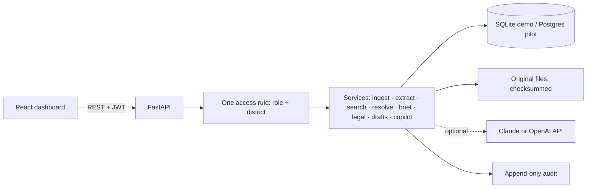

# U-FIR ANVESHANA (అన్వేషణ): AI-Enabled Unified First Information Report

**Challenge:** AI-Enabled Unified FIR · AP Prohibition & Excise Department · AI Living Labs Foundation (Hackathon ID HCK_8E2E98DE568DB1A4)
**One line:** an evidence-first intelligence layer over existing Excise case files. Every AI statement links to its source passage, every uncertain match stays reviewable, and the officer stays in control.

> Prototype on **synthetic data only** (no real records, accused persons or live systems). Full limits: [docs/LIMITATIONS.md](docs/LIMITATIONS.md).

## The problem and our approach
Excise case records are free text in many station formats. Officers search by hand, miss repeat offenders hidden behind spelling variants, and retype diaries and chargesheets. U-FIR ANVESHANA reads records **as they are written today** (no template change for officers) and turns them into: searchable facts → a cited case brief → explainable links → reviewed drafts → an audit trail.

## Official capabilities and outcomes → what to look at
| Brief | Delivered | Screenshot |
|---|---|---|
| C1/O1 Messy files → searchable data | **Upload Case Files** (text, Word, PDF, scanned images with open-source OCR): the system reads each file, suggests document type, case and registration date, flags duplicates, lets the officer confirm or create the case, then extracts, fact extraction with source quotes, **case metadata read from the documents** (offence type with the evidence behind each tag and officer correction, persons, vehicles, items, places, sections, keywords) with keyword search that explains why each case matched, autocomplete, filters and spelling-variant tolerance | [12](docs/screenshots/12-cases-metadata-keyword-search.png), [04](docs/screenshots/04-search-spelling-variants.png), [13](docs/screenshots/13-upload-impact-on-network.png) |
| C2 Understand a case quickly | Case Cockpit: cited brief, timeline, conflicts, missing information, one-click source highlighting | [02](docs/screenshots/02-case-cockpit-cited-brief.png) |
| C3 Suggest laws/sections | Catalogue-limited suggestions with cited facts and passages; abstains when facts are thin; accept/reject with reasons | [03](docs/screenshots/03-legal-suggestions.png) |
| C4/O3 Repeat offenders and networks | **Investigation Network**: repeat-offender clusters, interactive graph (find, filter, layouts, focus a neighbourhood, click for details and evidence), conservative matching (never name alone), human confirm/reject, accessible table; after every upload the system shows exactly which people and vehicles now connect to which other cases and lets the reviewer decide each lead in place; scales by indexed matching, caching and server-side limits (measured: 8,725 people / 5,000 cases refresh in 10 s, one new case in 1.3 s) | [05](docs/screenshots/05-investigation-network.png) |
| C5/O2 Reduce paperwork | Document Studio: case diary and chargesheet drafts from facts, placeholders block submission, versions, supervisor approval, export | [07](docs/screenshots/07-document-studio-draft.png) |
| O4 Hotspots | Ranked places/stations/months with coverage and caveats (no map: text has no coordinates) | [09](docs/screenshots/09-hotspots.png) |
| O5 Role-aware chatbot | Copilot answers only from records the user may access, with citations or an honest “not found” | [06](docs/screenshots/06-copilot-cited-answer.png) |
| Running the case, not just reading it | **Case management** tab: accused and custody status, seizure register (malkhana) with sample and lab tracking filled from the records, chargesheet/remand/hearing deadlines with overdue warnings (dashboard card and Deadlines page), a short compliance checklist, CSV export | [15](docs/screenshots/15-case-management.png) |
| Reviewable AI decisions | Append-only Audit Ledger; Review Queue for every pending human decision | [08](docs/screenshots/08-review-queue.png), [11](docs/screenshots/11-audit-ledger.png) |
| API or dashboard | Both: React dashboard + documented REST API (OpenAPI at `/docs`) | [00](docs/screenshots/00-login.png), [01](docs/screenshots/01-command-center.png) |

## Name and language
**అన్వేషణ (Anveshana)** means *investigation, exploration and discovery*: finding what the records already say and showing the evidence for it. The whole workspace switches between **English and Telugu** with one click (top bar), with a smooth cross-fade, Telugu typography (no letter-spacing, suitable fonts), Telugu dates, the choice remembered across visits, and the same accessibility results in both languages. Navigation, headings, filters, statuses, the case lifecycle, dashboards and quotations are translated; **case content (extracted facts, quoted passages, draft text, legal catalogue) is shown as recorded and is not machine-translated.** The Telugu was drafted for this prototype and should be reviewed by a native speaker and the department, especially police and legal terms ([18](docs/screenshots/18-telugu-sign-in.png), [19](docs/screenshots/19-telugu-command-center.png), [20](docs/screenshots/20-telugu-case.png)).

## Interface
A calm, official police-service workspace in an India-flag colour scheme: saffron and green accents on a deep navy-blue base, a tricolour bar across the top, and our own police-style badge (a star in a laurel wreath inside a saffron-white-green ring). The badge, colours and layout are original; **no State Emblem, national flag, Ashoka Chakra or real police emblem is drawn or imitated**, so nothing can be mistaken for an official mark. Quotations (Preamble to the Constitution, *Satyameva Jayate*, the Supreme Court's motto, the Peelian principle, labelled "attributed") rotate on the sign-in page and appear as a daily "Thought for the day". Also: an **Emergency 112** strip, rank-style insignia on the user chip, a **case-file ribbon** and a **lifecycle stepper** (Registered → Seizure → Samples and lab → Custody → Chargesheet → Court) on every case, a **daily briefing** that refreshes after each saved change, grouped dropdown navigation, breadcrumbs, a quick-find palette (Ctrl/⌘ + K), `/` for search, `?` for shortcuts, toasts, animated counters, a station × month heatmap, text-size and light/dark controls, and a responsive mobile menu ([00](docs/screenshots/00-login.png), [01](docs/screenshots/01-command-center.png), [16](docs/screenshots/16-case-lifecycle-stepper.png), [17](docs/screenshots/17-hotspot-heatmap.png), [14](docs/screenshots/14-quick-find.png)). To adopt an official emblem, the department can replace `frontend/src/Crest.tsx` and `frontend/public/favicon.svg`.

## What makes it different
1. **Evidence first.** Brief lines, legal suggestions, draft sections and Copilot answers cite verbatim passages; clicking opens the original with the quote highlighted.
2. **No reckless merging.** Same-name lookalikes (two “Lakshmi Devi”, a different “Ramesh Naidu”) are provably not linked; candidates need a reviewer's reason.
3. **Honest about uncertainty.** Wording is “named in the records”, never “guilty”. The chargesheet draft lists persons named and tells the officer to decide who is charged. OCR and Telugu documents are always sent for human review.
4. **Honest about the risk target.** The brief asks for “>90% accuracy in predicting risk” without defining risk. We ship “Not configured / not evaluated” and claim no figure.
5. **Measured, including failures.** A held-out extraction test is on the Quality & Governance page with the exact misses ([10](docs/screenshots/10-quality-governance.png)).

## Architecture (deliberately small)

Open-source stack: FastAPI, SQLAlchemy, React, Cytoscape, RapidOCR, pypdf, rapidfuzz. The LLM is optional (Copilot wording only); extraction, matching, briefs and drafts are deterministic and run offline.

## Security and privacy (enforced in code, tested)
Every endpoint authenticated; one shared access check (role + district) applied to search, snippets, counts, citations, graph, Copilot and exports; restricted records return the same 404 as missing ones; login rate limiting; security headers and CSP; no-store caching of API data; parameterised SQL; upload type/size limits with server-chosen filenames; prompt-injection text in documents is treated as data (a test seeds one); audit rows hold references, not document text; synthetic data only.

## Quality evidence
- **135 automated tests**, including a role × endpoint access matrix (every endpoint against every role, plus a cross-district no-leak check), covering access scoping, no-leak, review rules, extraction, matching, drafts, Copilot, OCR, hardening. The full demo journey was also driven end to end in a browser.
- **Accessibility:** automated axe-core scan (WCAG 2.2 A/AA rules) across 16 views in light and dark themes: 0 violations; keyboard focus styles, skip link, quick-find palette, text-size control, table alternatives to graph. Automated scans are supporting evidence, not a full audit.
- **Extraction (held-out, 6 synthetic documents, 37 facts):** precision ≈ 84%, recall ≈ 84%; person recall 56%, place precision 56%. Small, single-annotator, synthetic: do not extrapolate.

## Run it
```bash
./run_demo.sh        # UI + API on http://localhost:8000
```
Login `sup_vizag` / `demo123` (others in README). Timed walkthrough: [docs/DEMO_SCRIPT.md](docs/DEMO_SCRIPT.md) · Pitch and video outline: [docs/PITCH_OUTLINE.md](docs/PITCH_OUTLINE.md).

## Pilot readiness (60 days, 3 districts, 5–10 users)
Ready: roles and district scoping, review workflows, audit, evaluation framework, API. Needed from the department: risk definition and labels, legal source, data sample and formats, hosting/retention policy, identity provider. Planned: Postgres backend (SQLite today), OCR/Telugu quality work on real scans, integration adapter if CCTNS is required. See [docs/LIMITATIONS.md](docs/LIMITATIONS.md) for open questions.
